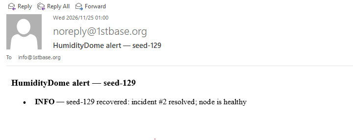

# Investigation — `tick` 502s and dirty-shutdown hardening

Status: **resolved** (Sprite tick recovered on its own after the initial analysis)
Last updated: 2026-11-25

## Resolution

The Sprite `tick` began succeeding again on its own after the initial analysis,
without any code change. This is consistent with **H1 (transient cold-start /
wake-up 502)** rather than a persistent dirty-shutdown fault — the 47s failure
was a one-off slow wake, and subsequent scheduled ticks returned to the normal
9–11s success path.

Because the cause was transient and self-clearing, the hardening below is kept
as **preventive** (observability + atomicity + retry) rather than a fix for an
active bug. The logging in Step 1 is still worth landing so that if a 502
recurs it is diagnosable instead of another guess.

## Symptom

The `tick` GitHub Actions workflow intermittently fails. The most recent
scheduled run failed with a `502` after ~47s, while healthy ticks complete in
9–11s.

| Run | Time (UTC) | Duration | Result |
|---|---|---|---|
| 45288074430 | 2026-11-23 23:21 | 9s | 401 unauthorized |
| 45288760273 | 2026-11-23 23:25 | 8s | 401 unauthorized |
| 45289593748 | 2026-11-23 23:31 | 9s | success |
| 45344572953 | 2026-11-24 06:59 | 11s | success |
| 45462118229 | 2026-11-24 18:40 | 54s | **502** (curl ran ~47s) |

The 401s are a known, already-documented token problem (see README). The 502 is
a **different** failure mode and is what this document is about.

## What a 502 means here

The Sprite proxy returns `502` when the upstream app (uvicorn) does not answer
in time. That happens for at least two distinct reasons that look identical from
GitHub's side:

1. **Slow cold start** — the Sprite was asleep and took too long to wake; the
   proxy gave up before uvicorn was serving.
2. **Dirty shutdown mid-request** — the VM woke, began the tick, then was
   suspended/killed before the response was produced.

We cannot yet distinguish these from the workflow log alone. **Confirming which
one it is is the first goal of this work** — hence the logging emphasis below.

## Why a dirty shutdown would be silent (code reading)

`run_tick` in `src/humiditydome/app.py` currently does, in order:

1. debounce check against `last_tick_ts` (lines 77–85)
2. **write `last_tick_ts` (line 86)**  ← happens *before* any work
3. `prune_old_data` (line 87)
4. probe all nodes (line 89)
5. per-node `insert_sample` — **each commits independently** (`store.py:243`)
6. alerts + optional report

There is **no `try/finally`, no integrity check, no single-flight guard**, and
the SQLite connection (`app.py:29`) is never closed. Consequences if the VM is
stopped mid-tick:

- `last_tick_ts` is already advanced, so the next tick within 15 min returns
  `"tick too soon"` and is **silently skipped** → a data gap with no error.
- Because each insert commits separately, a stop partway through the node loop
  leaves a **partial tick** (some nodes persisted, others missing).
- Nothing reconciles either condition afterward.

Durability note: `journal_mode=WAL` + `synchronous=NORMAL` (`store.py:122–123`)
protects against database *corruption* — a torn WAL tail is rolled back on next
open — but it does **not** make a multi-statement tick atomic, and it does not
advance/rewind `last_tick_ts` for us.

> SQLite has no MANIFEST or LOCK file (that is LevelDB/RocksDB). The "manifest"
> role is played internally by the DB header + WAL. So the hardening below does
> **not** add manifest/lock files — it relies on WAL atomicity plus a single
> transaction per tick.

## Working hypotheses (unconfirmed)

- **H1 — cold-start timeout.** The 47s duration is the proxy waiting on a slow
  wake. No tick ran; DB untouched. *Expected evidence:* `last_tick_ts` still at
  the previous successful tick; no logs from this run.
- **H2 — dirty shutdown mid-tick.** The VM stopped partway through the tick.
  *Expected evidence:* `last_tick_ts` advanced to ~18:40 but missing/partial
  samples for that timestamp; uvicorn received the request (an access log line)
  but never logged completion.
- **H3 — something else** (proxy/network blip, OOM, etc.). *Expected evidence:*
  neither of the above cleanly fits.

## Plan: observability first, then logical hardening

Because we are still speculating, **step 1 is to make the system observable** so
the next 502 is diagnosable rather than another guess. Only then do we apply the
targeted fixes. No manifest/lock files, no external cache — keep it minimal.

### Step 1 — debug logging (do first)

Add the stdlib `logging` module (none exists today) and instrument the tick
path so a run can be traced end-to-end. Target log points:

- `run_tick` entry/exit with `run_id`, `now`, and the debounce decision
  (skipped vs. running, with `last_tick_ts`).
- Each phase boundary: `prune` → `probe_start` → `probe_done` (per-node ok/fail +
  latency) → `insert` (per node) → `alerts` → `report`.
- The `last_tick_ts` write, with old → new value.
- A completion line with total duration and node count.
- `probe.fetch_status` failures (already captured as `Sample.error`; surface at
  debug/warning).
- Startup: config path, DB path, node count, `dry_run`, and a `quick_check`
  result (see step 2).

Format: structured key=value lines (e.g. `tick run_id=… phase=probe_done
nodes=6 dur_ms=…`) so a suspended run is obvious from the *last* line emitted.
Level configurable via `HUMIDITYDOME_LOG_LEVEL` (default `INFO`).

### Step 2 — logical hardening (after logging lands)

- **Atomic tick.** Make the write phase of `run_tick` a single transaction
  (`BEGIN … COMMIT`) covering samples, node state, incidents, and the
  `last_tick_ts` update. A dirty stop then rolls the whole tick back via WAL —
  no partial entries, and `last_tick_ts` does not advance.
- **`last_tick_ts` written last, inside that transaction.** An interrupted tick
  re-runs on the next trigger instead of being skipped.
- **Single-flight guard.** An in-process `asyncio.Lock` so overlapping `/tick`
  calls return `{"ok": true, "skipped": true, "reason": "run in progress"}`
  (HTTP 200). In-memory only — a restart clears it; nothing to hang.
- **Integrity smoke test.** `PRAGMA quick_check` at startup and in `/healthz`;
  `PRAGMA wal_checkpoint(TRUNCATE)` once on startup. Cheap insurance, not a
  per-tick gate.
- **Workflow retry.** `curl --retry 2 --retry-delay 5 --retry-all-errors
  --max-time 90` in `tick.yml` so a transient wake-up 502 retries once instead
  of failing the run.

### Step 3 — confirm and close

After the next 502 (or a forced repro), read the logs to confirm H1 vs H2,
then keep or adjust the hardening. Update this file with the finding and mark
resolved.

### Step 4 — README screenshot (only after tweaks are done and tested)

Once the Step 1–2 changes are implemented **and** the test suite passes, add the
resolved-alert screenshot to the README so the recovery is documented visually.
The file already exists at `docs/screenshot-resolved-alert.png` and follows the
same convention as the two existing screenshots
(`README.md:141` and `README.md:145`):

```markdown

```

Place it near the existing alert screenshots in the README. Do **not** add it
before the code changes are tested — this step is explicitly gated on "done and
tested". (Note: the screenshot image itself could not be visually verified during
this analysis — the model used does not support image input — so confirm it
depicts the resolved/recovery alert before publishing.)

## Files expected to change

- `src/humiditydome/logging_setup.py` (new) — logger config from env.
- `src/humiditydome/app.py` — instrument `run_tick`; single-flight; atomic
  transaction; integrity in `/healthz`.
- `src/humiditydome/store.py` — `check_integrity`; transaction helper;
  `last_tick_ts` only on success.
- `src/humiditydome/probe.py` — debug log on failure.
- `tests/` — single-flight skip, rollback-on-failure (timestamp not advanced),
  integrity ok/bad.
- `.github/workflows/tick.yml` — retry/back-off.
- `README.md` — document the recovery model.

## Open questions

- Is the Sprite a single uvicorn worker? (Single-flight assumes yes; if multiple
  workers, the guard must be per-process and the DB transaction still holds.)
- Do we want a `warning`-severity alert email when a tick is skipped due to
  single-flight, or only a log line? (Current lean: log only.)