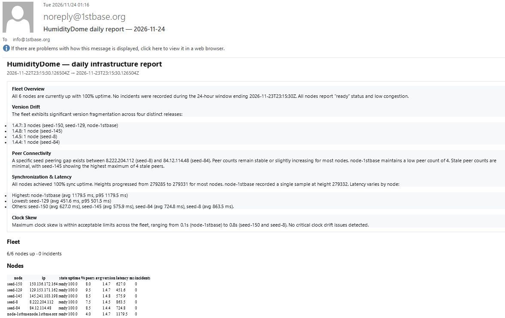
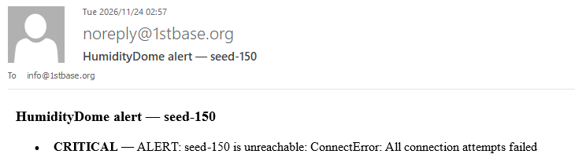
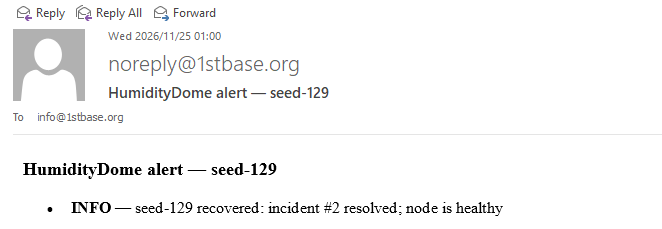

# HumidityDome

**Infrastructure heartbeat for the 1stBase blockchain.**

HumidityDome is a small, self-hosted monitoring agent that watches the health of your
blockchain seed nodes. It polls each node, validates its sync / peer / version state, and
emails a clean daily summary plus instant alerts when something breaks.

It runs on a **Fly.io Sprite** — a persistent, hardware-isolated VM that sleeps when idle
and wakes on request. That gives the agent real local state (SQLite) without paying for an
always-on server.

> **Status: WIP** — v1 targets the 5 seed nodes and preview/interactive node. Websites are out of
> scope for now.

---

## Why

Running a blockchain means babysitting seed nodes. HumidityDome does the babysitting: it
turns noisy node JSON into a one-line-per-node morning email, and pings you the moment a
node goes dark, loses peers, or stops syncing. So you can proactively track version-specific 
performance and tend to your seeds before they sprout poor branches on the network.

## How it works

```
            every hour (cron-job.org or any HTTP scheduler)
                          |
                          v
              +---------------------+
              |  Fly.io Sprite      |   persistent VM, wakes on request
              |  (FastAPI service)  |
              +----------+----------+
                         |
        +----------------+----------------+
        |                |                |
        v                v                v
    seed nodes        Groq (LLM)      Resend (email)
    (6x HTTP)         (summary)       (alerts + daily)
        |            via Sprites      via Sprites
        |            connectors       connectors
        v
    SQLite (persistent ext4 disk)
```

- The Sprite **sleeps when idle** and **wakes on each tick** — you only pay for the seconds
  it actually works.
- State lives in **SQLite on the Sprite's persistent ext4 disk**, so it survives warm and
  cold pauses with no external database to run.
- **Sprites connectors** hold the Groq and Resend credentials; the Sprite never sees the
  tokens.
- The LLM only writes prose; **all numbers are computed in code** — that is what keeps the
  summary "error-free".
- **7-day retention:** samples, incidents, and reports older than 7 days are deleted on
  every tick (`paths.retention_days`). At hourly polling and 6 nodes that's ~1,000 sample
  rows — the SQLite file stays tiny and the LLM context stays well under free-tier limits.

## Why Fly.io Sprites

Sprites are the reason this is one small service instead of a server, a volume, and a
database:

- **Persistent compute without a server.** A Sprite is a hardware-isolated VM with a real
  ext4 filesystem. SQLite, installed packages, and files survive warm and cold pauses — no
  external database or volume plumbing.
- **Idle-aware by default.** The Sprite sleeps when nothing is happening and wakes on the
  next request (100–500 ms warm, 1–2 s cold). An hourly poll means the VM is asleep for
  the vast majority of the day.
- **Wake-on-request.** Every Sprite gets an HTTPS URL. An inbound request wakes it, so an
  external cron can drive the agent without an always-on process.
- **Services that survive sleep.** `sprite-env services` starts the FastAPI service at boot
  and restarts it after a cold wake, so the URL always answers.
- **Connectors for secrets.** Groq and Resend credentials live in the org, not in the
  Sprite. The Sprite calls them through the Sprites gateway with deny-by-default access
  policies.
- **Checkpoints.** Snapshot the entire filesystem before a risky change and restore if
  needed.

That combination — real disk, hardware isolation, idle-aware billing, and managed
credentials — is what makes a "monitor my infrastructure" agent practical to run for free.

## Monitored signals (v1)

- Reachability / HTTP latency
- `state` (`ready`, …) and `version`
- Sync: `isSynchronized` + divergence between `currentHeight` / `targetHeight` /
  `p2pHeight` / `explorerHeight` vs `tolerance`
- Peers: count vs `minPeers`, inbound/outbound, **stale peers**, **seed-to-seed
  connectivity matrix**
- Clock skew (node `timestamp` vs UTC)
- Mempool: `congestionLevel`, `pendingSwaps`, `cachedTransactions`
- Capabilities: `canMine`, `canServeBlocks`, `canCreateTx`, `mining.hasEnoughPeers`

## Seed nodes (v1)

| Name     | Endpoint                                                |
|----------|---------------------------------------------------------|
| seed-150 | `http://150.136.172.164:3001/api/node/state/status`     |
| seed-129 | `http://129.153.171.162:3001/api/node/state/status`     |
| seed-145 | `http://145.241.103.198:3001/api/node/state/status`     |
| seed-8   | `http://8.222.204.112:3001/api/node/state/status`       |
| seed-84  | `http://84.12.114.48:3001/api/node/state/status`        |
| node-1stbase | `https://node.1stbase.org/api/node/state/status`    |

## Alerts

A node triggers an email alert when it:

- is **unreachable** (connection error / timeout / non-2xx / `success:false`)
- **loses peers** (≥40% drop vs last check, or below `minPeers`)
- has **unstable sync** (`isSynchronized:false`, `state != ready`, or height divergence
  beyond `tolerance`)
- has **clock skew** beyond the threshold
- shows a **seed-to-seed peering gap**

Alerts are debounced by **2 consecutive failures**, then deduplicated **per node**: at most
**one alert email per node per 24 hours**, even if the node keeps flapping. Recovery
notices are still sent when it comes back.

## Daily report

At **09:00 UTC+2** the agent compiles the last 24 h into a compact rollup, asks
`qwen/qwen3.8-27b` (Groq) to write a professional summary, and emails it to
`info@1stbase.org` via a Resend **Sprites connector**.

It sends even if a **manual** `POST /report` went out earlier the same day. Reports are
tagged by kind: `manual` vs `scheduled`. Only a **scheduled** report counts as "sent
today", so the 09:00 summary always goes out and you never get two scheduled reports in one
day.

## Data retention

HumidityDome keeps a rolling **7-day** window. On every tick, `prune_old_data()` deletes
`samples`, `incidents`, and `daily_reports` older than `paths.retention_days` (default 7).
At hourly polling and 6 nodes that is ~1,000 sample rows — the SQLite file stays small
and the daily LLM context stays well under free-tier token limits.

## Screenshot



*The daily report: raw node telemetry compiled into a clean, readable email.*



*Instant alert when a node goes unreachable — one email per incident, no duplicates.*



*Recovery notice when a node comes back — the same incident thread, closed automatically.*

## Tech stack

- **Fly.io Sprites** — persistent, hardware-isolated VM; sleeps when idle, wakes on request
- Python 3.12, FastAPI, httpx, SQLite (WAL) on the Sprite's persistent disk
- **cron-job.org** / GitHub Actions (HTTP trigger) — any scheduler works
- Groq (LLM) + Resend (email) via **Sprites connectors**

## Repo layout

```
.
├── README.md
├── TODO.md
├── requirements.txt
├── .github/workflows/tick.yml
├── config/nodes.yaml
├── src/humiditydome/
│   ├── app.py        # FastAPI: /healthz /tick /status /report
│   ├── config.py
│   ├── models.py
│   ├── probe.py      # fetch + parse node status
│   ├── store.py      # SQLite state
│   ├── alerts.py     # fault detection
│   ├── llm.py        # Groq via connector
│   ├── mail.py       # Resend via connector
│   └── report.py     # daily rollup + email
└── tests/
```

## Setup

### 1. Prerequisites
- A Fly.io account and the `sprite` CLI (`curl -fsSL https://sprites.dev/install.sh | sh`)
- A Groq API key
- A Resend account + DNS access for `1stbase.org`
- The GitHub repo `1stBaseFoundation/HumidityDome`

### 2. Sprites connectors (keys never touch the code)
- **Groq**: custom API connector, `base_api_url=https://api.groq.com`, header `Bearer`,
  token = Groq key. Grant access to the `humiditydome` Sprite.
- **Resend**: custom API connector, `base_api_url=https://api.resend.com`, header `Bearer`,
  token = Resend key. Grant access to the `humiditydome` Sprite.

### 3. Resend
1. Add `1stbase.org` in Resend → **Domains**.
2. Add the SPF / DKIM / DMARC DNS records it gives you.
3. Create a **Sending access** API key.
4. From: `noreply@1stbase.org` (Reply-To `info@1stbase.org`), To: `info@1stbase.org`.
   You do **not** need to create a `noreply@` mailbox — Resend authenticates the domain,
   not the mailbox.

### 4. Deploy the Sprite

> **There is no auto-deploy.** The Sprite runs whatever source was last copied into
> `/home/sprite/humiditydome` — pushing to GitHub does not change it. A merged fix
> keeps "still happening" until you copy the files and restart the service.

```bash
sprite create humiditydome
sprite use humiditydome

# first deploy: clone and install into the Sprite's own venv
sprite exec -- bash -c "git clone https://github.com/1stBaseFoundation/HumidityDome /home/sprite/humiditydome && \
  python3 -m venv /home/sprite/humiditydome/.venv && \
  /home/sprite/humiditydome/.venv/bin/pip install -r /home/sprite/humiditydome/requirements.txt"

sprite-env services create web \
  --cmd /home/sprite/humiditydome/.venv/bin/uvicorn \
  --args "humiditydome.app:app,--host,0.0.0.0,--port,8080" \
  --dir /home/sprite/humiditydome/src \
  --http-port 8080
```

Redeploy after every change:

```bash
# 1. copy the new tree in (works even if the Sprite's copy is not a git checkout)
sprite exec -- bash -c "cd /tmp && rm -rf hd-src && mkdir hd-src && \
  curl -fsSL https://github.com/1stBaseFoundation/HumidityDome/archive/main.tar.gz | \
  tar xz -C hd-src --strip-components=1 && \
  cp -a hd-src/src hd-src/config /home/sprite/humiditydome/"

# 2. restart so uvicorn loads the new code
sprite exec -- sprite-env services restart web

# 3. verify the running code is the new code
sprite exec -- grep -n "heartbeat" /home/sprite/humiditydome/src/humiditydome/app.py
```

The database at `/home/sprite/humiditydome/humiditydome.db` is never touched by a
deploy — it lives on the Sprite's persistent ext4 disk and survives every sleep, so
there is no external database to provision.

### 5. Scheduling (the trigger)

The Sprite sleeps when idle, so it needs an external HTTP request to wake it. **One trigger
is enough** — this deployment uses a single hourly cron-job.org job. A second scheduler is
not more reliable, it just doubles the cold-wake attempts and the noise.

1. Create a cronjob at **https://cron-job.org**.
2. **URL:** `https://<sprite-name>-<org-id>.sprites.app/tick`
3. **Schedule:** every hour.
4. **Method:** `POST`
5. **Header:** `Authorization: Bearer <SPRITES_TOKEN>`
6. **Body:** `{}`
7. Save → **Run now** to test.

A cron-job.org request completes in a few seconds: it fires at `:00`, the Sprite wakes in
1–2s, and the app answers in ~1s — far inside the free 30-second timeout. The daily report
tick (wake + probes + LLM + email) can run longer than 30s, so cron-job.org may log a
timeout on that one run even though the email still sends server-side; that is cosmetic.

Free cron-job.org is capped at 100 requests/day (24 here) and can occasionally drop a run.
When that happens the [watchdog](#6-watchdog-detect-missed-ticks) tells you, and you can
`Run now` by hand. If a single trigger proves too flaky in practice, the minimal escalation
is a **second cron-job.org entry at a different minute** — still one service, no new
infrastructure — not another scheduler platform.

#### Which token goes in `SPRITES_TOKEN`?

This is the easiest step to get wrong. Fly.io has two different token screens:

| Where you create it | Token format | Works for Sprite URLs? |
|---|---|---|
| **Sprites → Tokens** (the Sprites dashboard) | `org-slug/org-id/token-id/token-value`, e.g. `1stbase/…` | ✅ Yes |
| **Organization → Tokens** (Fly.io org settings) | `FlyV1…` | ❌ No — returns `401 {"error":"unauthorized"}` |

Create the token under **Sprites → Tokens**, with the correct organization selected
(the org that owns the Sprite — `1stbase` in this deployment). Sign in as the
account that owns that org, then copy the **entire** token string.

A `401 {"error":"unauthorized"}` almost always means a `FlyV1…` Fly.io organization token
was used instead of a **Sprites → Tokens** token. Recreate it in the Sprites dashboard.

#### Manual trigger (GitHub Actions)

`.github/workflows/tick.yml` has no schedule — it exists only so you can fire a tick by
hand from the **Actions** tab (`Run workflow`). It needs the same two repository secrets
(`SPRITE_URL`, `SPRITES_TOKEN`) and retries the wake for ~5 minutes, which is handy when
you want to force a run outside the cron.

### 6. Watchdog (detect missed ticks)

The Sprite cannot report its own silence: if it never wakes, no code runs to tell you. A
dead-man's switch closes that gap — the app pings an external watchdog after every completed
tick, and the watchdog emails you when the pings stop.

1. Create a check at **https://healthchecks.io** (free plan: 20 checks).
2. **Period:** 1 hour, **Grace:** 30 minutes.
3. Add the ping URL to `config/nodes.yaml` (or set `HUMIDITYDOME_HEARTBEAT_URL` on the Sprite):

   ```yaml
   paths:
     heartbeat_url: "https://hc-ping.com/<uuid>"
   ```

4. Redeploy and restart (§4), then confirm a tick reports `"heartbeat": true`.

The ping URL is not a credential — it only records that a tick finished, so it is safe to
keep in config. A failed ping never fails the tick.

## Local development

```bash
pip install -r requirements.txt
uvicorn humiditydome.app:app --reload
curl -X POST localhost:8000/tick
```

Set `HUMIDITYDOME_DRYRUN=1` to skip real emails while developing.

## Cost & scaling

At the current 6-node / 24-poll-per-day scale, this fits comfortably within free tiers:

| Component | Usage | Free tier |
|---|---|---|
| **Sprites** | a few seconds of compute per tick; asleep the rest of the time | idle-free |
| **Groq** | 1–2 calls/day, ~400-token prompts | free developer plan |
| **Resend** | ~30–60 emails/month | 3,000/month |
| **cron-job.org** | 24 runs/day | 100 requests/day (free) |
| **GitHub Actions** | manual runs only — public repo, so minutes are unmetered | unlimited (public) |
| **healthchecks.io** | 1 check, 24 pings/day | 20 checks |

The design is usage-based: the Sprite is only active for the few seconds it takes to probe
the nodes and persist a tick. **At current scale the target is $0/month.**

**Scaling:** at 100 nodes the tick is still a few seconds of compute, and a paid Sprites
plan covers it for a few dollars a month. The architecture doesn't change — only the
volume.

## Security

- No secrets in the repo. Groq / Resend tokens live in **Sprites connectors** — the Sprite
  never sees them; it calls the gateway and the connector attaches the credential.
- `SPRITES_TOKEN` lives in **GitHub Actions secrets** (or the cron-job.org request header)
  and must be a **Sprites → Tokens** token (`org-slug/…`), not a Fly.io organization token
  (`FlyV1…`).
- The Sprite URL is private by default (org-only, token-authenticated).
- The watchdog ping URL is **not** a credential — it only records that a tick finished, so it
  lives in `config/nodes.yaml`. The scheduler token lives in the cron-job.org request header
  (or GitHub Actions secrets for manual runs), never in the repo.
- Connector access is deny-by-default: only the `humiditydome` Sprite can use the Groq and
  Resend connectors.

## License

MIT — see [LICENSE](LICENSE).
